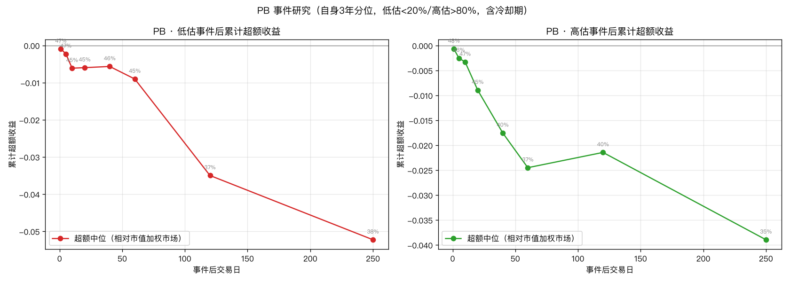
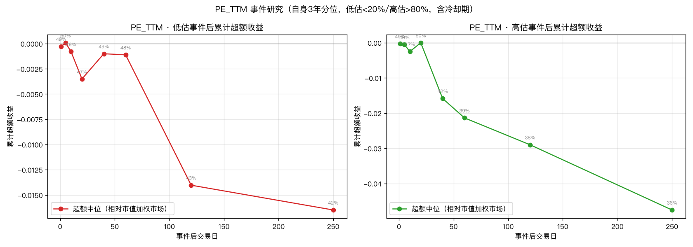

# 05 · 估值事件研究报告（低估会不会涨 / 高估会不会跌）

> 生成：2026-10-14 20:45 · 脚本 `research/prosperity/05_valuation_event_study.py`（v3）
> 数据：`daily_basic`（个股 PB/PE）+ 申万二级成分映射 + 行业收益
> 方法：事件研究 —— 行业估值滚动 3 年自身历史分位，低估≤20% / 高估≥80%，
> 含冷却期（须回到 40%~60% 中性区才重新计数）。
> 收益用复利、超额基准 = 市值加权市场收益。以中位数 + 胜率为准。

## 与 03/04 的本质区别

- 03/04 测「横截面排序预测力」（相对贵/便宜），已证伪。
- 本报告测「自身历史极值后的时间分布」——直接回答直觉问题。

## PB

事件总数：低估 746 / 高估 730

### 低估事件

| 交易日 | 超额中位 | 超额胜率 | 超额 t(Winsor) | 绝对中位 |
|---|---|---|---|---|
| 1 | -0.09% | 47% | +0.61 | +0.10% |
| 5 | -0.23% | 47% | +0.98 | +1.06% |
| 10 | -0.61% | 45% | -1.28 | +0.81% |
| 20 | -0.60% | 45% | -0.46 | +1.85% |
| 40 | -0.56% | 46% | +1.19 | +3.74% |
| 60 | -0.90% | 46% | +0.20 | +4.01% |
| 120 | -3.50% | 39% | -2.58 | +5.35% |
| 250 | -5.22% | 41% | -1.18 | +16.50% |

### 高估事件

| 交易日 | 超额中位 | 超额胜率 | 超额 t(Winsor) | 绝对中位 |
|---|---|---|---|---|
| 1 | -0.07% | 48% | +0.70 | +0.00% |
| 5 | -0.25% | 46% | -1.19 | +0.13% |
| 10 | -0.33% | 47% | +0.31 | +0.44% |
| 20 | -0.89% | 45% | +0.02 | +0.78% |
| 40 | -1.75% | 42% | -2.04 | +1.17% |
| 60 | -2.45% | 38% | -1.79 | +2.11% |
| 120 | -2.14% | 44% | +0.20 | +6.68% |
| 250 | -3.89% | 43% | -0.27 | +15.67% |

## PE_TTM

事件总数：低估 694 / 高估 584

### 低估事件

| 交易日 | 超额中位 | 超额胜率 | 超额 t(Winsor) | 绝对中位 |
|---|---|---|---|---|
| 1 | -0.03% | 49% | +0.58 | +0.22% |
| 5 | +0.01% | 50% | +3.00 | +0.85% |
| 10 | -0.08% | 49% | +1.99 | +1.28% |
| 20 | -0.35% | 48% | +1.57 | +2.14% |
| 40 | -0.10% | 50% | +2.75 | +3.64% |
| 60 | -0.11% | 50% | +2.29 | +4.15% |
| 120 | -1.40% | 46% | +2.51 | +7.95% |
| 250 | -1.65% | 46% | +2.78 | +17.60% |

### 高估事件

| 交易日 | 超额中位 | 超额胜率 | 超额 t(Winsor) | 绝对中位 |
|---|---|---|---|---|
| 1 | -0.03% | 49% | +2.20 | +0.01% |
| 5 | -0.05% | 49% | +1.12 | +0.09% |
| 10 | -0.25% | 47% | +1.24 | +0.59% |
| 20 | -0.00% | 50% | +1.08 | +1.60% |
| 40 | -1.59% | 43% | -0.67 | -0.05% |
| 60 | -2.14% | 40% | -1.98 | +1.85% |
| 120 | -2.90% | 40% | -1.02 | +5.26% |
| 250 | -4.75% | 41% | +1.36 | +14.61% |

## 结论

**用户直觉的检验结果：「低估会涨、高估会跌」在申万二级行业层面基本不成立。**

1. **低估会不会涨？** PB 低估事件后，超额中位数全窗口为负（120日 -3.5%、胜率仅 39%），
   且 PB 低估在 120 日窗口显著**跑输**市场（t=-2.58）。PE 低估事件后超额≈0（胜率 46-50%），
   也不存在「等多久就会涨」的兑现规律——250 日超额中位仍为 -1.65%。
   ⇒ **没有「低估后某段时间会补涨」的时间分布规律**。

2. **高估会不会跌？** 同样不成立。PB 高估事件后 250 日超额中位 -3.9%（胜率 43%），
   PE 高估事件后 250 日 -4.75%（胜率 41%）——高估行业确实长期略跑输，**但方向弱、
   兑现慢、胜率不到 45%**，作为交易信号不可用；且这与 03 报告横截面结论一致
   （估值排序无前瞻力），不是新信号。

3. **绝对收益全为正是牛熊假象**：事件后绝对收益中位 250 日约 +15~18%，但这是
   2020-2026 样本期市场整体上行的结果，与估值极值无关（高估组一样 +15%）。

4. **一个值得注意的次级现象**：无论低估还是高估，事件后超额中位数都**系统性为负**
   （胜率 39-46%）。即估值极值事件（无论方向）后，行业倾向略跑输市场。
   可能的解释：估值极值往往由前期的剧烈单边行情造成，之后动能衰减/均值回归
   表现为相对市场走弱。此为探索性观察，未做事后校正。

**方法论备注**：本报告与 03/04 合并构成估值腿的完整证伪——
横截面排序（03/04）与自身历史极值事件（本报告）两种口径下，
估值都不携带「价格之外、领先于价格」的信息，只反映已发生的价格结构。
符合方法论铁律：估值只能当过滤器/风险提示，不能当预测信号。
