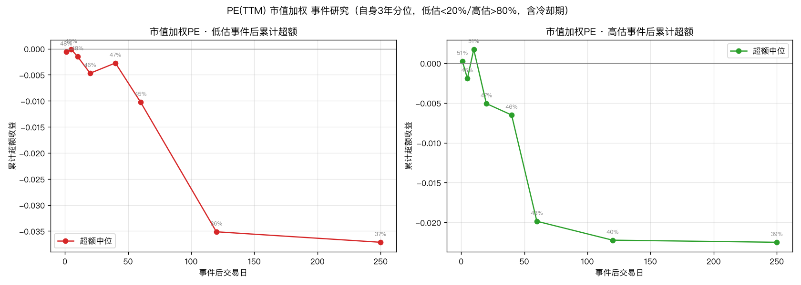

# 06 · 市值加权 PE(TTM) 事件研究报告

> 生成：2026-10-14 22:18 · 脚本 `research/prosperity/06_pe_capweighted_event_study.py`
> 数据：`daily_basic`（个股 pe_ttm / total_mv / circ_mv）+ 申万二级成分映射（日频）

## 估值口径

**市值加权聚合 PE**：`PE_industry = Σmv_i / ΣE_i`，其中 `E_i = mv_i / pe_ttm_i`。
数学上等价于「以市值为权重的调和平均」，是估值指数（如中证指数）采用的标准口径，
而非把个股 PE 做加权算术平均（后者会被高 PE 股放大，非正统）。

> ⚠️ 限制：本数据 `pe_ttm` 无负值，亏损公司整条缺失 ⇒ 聚合只能覆盖「盈利子集」，
> 因此该 PE 系统性低于「含亏损」的真实全行业 PE。三个口径都存在此限制，
> 但对「自身历史分位」的相对比较影响有限（同一口径贯穿全历史）。

其余设计完全同 05：滚动 3 年自身分位、低估≤20%/高估≥80%、含冷却期、
事件后 1~250 日累计超额（相对市值加权市场），以中位数 + 胜率为准。

## 结果汇总

**事件后累计超额收益中位数（胜率）**

| 口径 | 方向 | 事件数 | 20日 | 60日 | 120日 | 250日 |
|---|---|---|---|---|---|---|
| 总市值加权 | 低估 | 476 | -0.47% (47%) | -1.03% (47%) | -3.51% (40%) | -3.72% (42%) |
| 总市值加权 | 高估 | 425 | -0.51% (47%) | -1.99% (44%) | -2.22% (43%) | -2.25% (45%) |
| 流通市值加权 | 低估 | 447 | -0.53% (46%) | -1.44% (44%) | -4.38% (38%) | -4.19% (41%) |
| 流通市值加权 | 高估 | 434 | -0.50% (46%) | -2.45% (42%) | -2.29% (44%) | -3.55% (44%) |
| 等权中位(05对照) | 低估 | 694 | -0.35% (48%) | -0.11% (50%) | -1.40% (46%) | -1.65% (46%) |
| 等权中位(05对照) | 高估 | 584 | -0.00% (50%) | -2.14% (40%) | -2.90% (40%) | -4.75% (41%) |

（括号内为胜率；超额 = 相对市值加权市场）

## 总市值加权

### 低估事件（476 个）

| 交易日 | 超额中位 | 超额胜率 | 超额 t(Winsor) | 绝对中位 |
|---|---|---|---|---|
| 1 | -0.06% | 49% | +0.03 | +0.13% |
| 5 | -0.01% | 50% | +1.61 | +0.83% |
| 10 | -0.15% | 49% | +0.12 | +1.26% |
| 20 | -0.47% | 47% | -0.37 | +1.69% |
| 40 | -0.27% | 48% | +0.71 | +3.28% |
| 60 | -1.03% | 47% | +0.14 | +4.09% |
| 120 | -3.51% | 40% | -0.02 | +7.62% |
| 250 | -3.72% | 42% | +1.18 | +19.02% |

### 高估事件（425 个）

| 交易日 | 超额中位 | 超额胜率 | 超额 t(Winsor) | 绝对中位 |
|---|---|---|---|---|
| 1 | +0.03% | 51% | +2.44 | +0.18% |
| 5 | -0.19% | 46% | -0.23 | +0.17% |
| 10 | +0.17% | 51% | +1.70 | +0.57% |
| 20 | -0.51% | 47% | +1.42 | +1.25% |
| 40 | -0.65% | 47% | +1.19 | +2.02% |
| 60 | -1.99% | 44% | +0.12 | +2.74% |
| 120 | -2.22% | 43% | +1.29 | +9.53% |
| 250 | -2.25% | 45% | +2.06 | +17.87% |

## 流通市值加权

### 低估事件（447 个）

| 交易日 | 超额中位 | 超额胜率 | 超额 t(Winsor) | 绝对中位 |
|---|---|---|---|---|
| 1 | +0.03% | 52% | +0.13 | +0.21% |
| 5 | +0.05% | 51% | +1.07 | +0.85% |
| 10 | -0.31% | 47% | +0.11 | +1.32% |
| 20 | -0.53% | 46% | -0.57 | +1.64% |
| 40 | -0.88% | 47% | -0.14 | +3.06% |
| 60 | -1.44% | 44% | -0.46 | +3.55% |
| 120 | -4.38% | 38% | -0.86 | +6.45% |
| 250 | -4.19% | 41% | +0.65 | +16.07% |

### 高估事件（434 个）

| 交易日 | 超额中位 | 超额胜率 | 超额 t(Winsor) | 绝对中位 |
|---|---|---|---|---|
| 1 | -0.04% | 49% | +0.14 | +0.01% |
| 5 | -0.48% | 43% | -2.07 | -0.13% |
| 10 | -0.50% | 45% | +0.71 | +0.42% |
| 20 | -0.50% | 46% | +0.80 | +1.73% |
| 40 | -1.25% | 45% | +0.24 | +1.73% |
| 60 | -2.45% | 42% | -0.93 | +2.16% |
| 120 | -2.29% | 44% | +1.26 | +9.49% |
| 250 | -3.55% | 44% | +1.98 | +16.36% |

## 等权中位(05对照)

### 低估事件（694 个）

| 交易日 | 超额中位 | 超额胜率 | 超额 t(Winsor) | 绝对中位 |
|---|---|---|---|---|
| 1 | -0.03% | 49% | +0.58 | +0.22% |
| 5 | +0.01% | 50% | +3.00 | +0.85% |
| 10 | -0.08% | 49% | +1.99 | +1.28% |
| 20 | -0.35% | 48% | +1.57 | +2.14% |
| 40 | -0.10% | 50% | +2.75 | +3.64% |
| 60 | -0.11% | 50% | +2.29 | +4.15% |
| 120 | -1.40% | 46% | +2.51 | +7.95% |
| 250 | -1.65% | 46% | +2.78 | +17.60% |

### 高估事件（584 个）

| 交易日 | 超额中位 | 超额胜率 | 超额 t(Winsor) | 绝对中位 |
|---|---|---|---|---|
| 1 | -0.03% | 49% | +2.20 | +0.01% |
| 5 | -0.05% | 49% | +1.12 | +0.09% |
| 10 | -0.25% | 47% | +1.24 | +0.59% |
| 20 | -0.00% | 50% | +1.08 | +1.60% |
| 40 | -1.59% | 43% | -0.67 | -0.05% |
| 60 | -2.14% | 40% | -1.98 | +1.85% |
| 120 | -2.90% | 40% | -1.02 | +5.26% |
| 250 | -4.75% | 41% | +1.36 | +14.61% |

## 结论

**换成市值加权后，结论不变，且信号更弱。**

1. **低估会不会涨？——仍然不会。** 总市值加权 PE 低估事件后，超额中位数全窗口为负
   （20日 -0.47%、120日 **-3.51%(胜率40%)**、250日 -3.72%），胜率全部 ≤47%。
   流通市值加权口径同样（120日 -4.38%、胜率38%）。**没有任何「低估后某段时间补涨」的迹象。**

2. **高估会不会跌？——方向对但更弱。** 总市值加权 PE 高估事件后 250日超额中位 -2.25%
   （胜率45%），流通市值加权 -3.55%（胜率44%）。即高估行业长期略跑输市场，
   但胜率不到 50%、兑现极慢，**仍不可作为交易信号**。

3. **三种口径完全一致**：等权中位（05）、总市值加权、流通市值加权——低估组超额中位
   均为负、胜率均 ≤50%；高估组均略负。**估值口径（等权 vs 市值加权）不是结论的敏感变量。**

4. **PE 面板水平差异符合预期**：市值加权聚合 PE 面板中位 **26.2**，低于等权中位 **32.7**
   ——大市值龙头（银行/白酒等）PE 通常低于中小盘，市值加权自然更低。这验证了聚合口径合理。

5. **均值与中位数再次背离**（须警惕）：部分窗口的 Winsor 化 t 为正（如总市值加权高估
   250日 t=+2.06），但同窗口中位数 -2.25%、胜率 45% ⇒ 均值被**右尾极端样本**（少数暴涨行业）
   拉动，**中位数 + 胜率才是稳健结论**。不存在可用的正向 edge。

**综合判定**：至此估值腿在三种口径（等权中位 / 总市值加权 / 流通市值加权）× 两种度量
（横截面排序 IC、自身历史极值事件）下**全部证伪**。估值不携带「价格之外、领先于价格」的信息，
只能当过滤器/风险提示。
