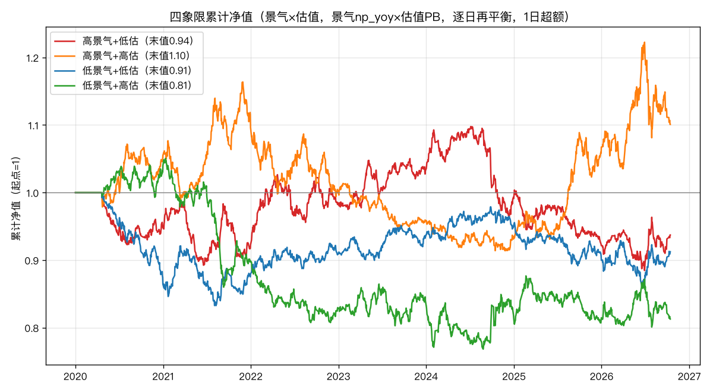

# 07 · 景气 × 估值 双因子合流验证报告

> 生成：2026-10-14 22:32 · 脚本 `research/prosperity/07_combined_signal.py`
> 数据：`industry_prosperity_panel.parquet`（景气 PIT）+ `daily_basic`（PB）+ 行业收益
> 方法：2×2 双重排序 + Fama-MacBeth 交互回归 + 3×3 探索性排序；按快照期 end_i 聚类 t。
> 统计量以**中位数**为主（均值被极端行业污染，同 03/05/06 教训）。

## 动机与假说

景气、估值两腿单测均无前瞻力（02/03/05/06）。经典价值理论认为：
**低估值只有在景气向上时才是「机会」，否则是「价值陷阱」** ⇒ 估值作用可能是
条件性的，需与景气**交互**才显现。本报告检验该假说。

## A. 2×2 双重排序（景气 np_yoy × 估值 PB）

数值 = 事件后累计超额**相对全行业中位数**（0 = 与典型行业持平），
括号内为按快照期聚类的 t（检验该象限是否显著偏离全行业中位）：

| 象限 | 观测数 | 20日 | 60日 | 120日 |
|---|---|---|---|---|
| 高景气+低估 | 36949 | +0.05% (t+0.12) | +0.08% (t-0.34) | +0.11% (t+0.03) |
| 高景气+高估 | 45011 | +0.23% (t+1.25) | +0.25% (t+1.68) | +0.68% (t+2.22) |
| 低景气+低估 | 43440 | +0.08% (t+1.58) | +0.73% (t+1.31) | +1.40% (t+2.61) |
| 低景气+高估 | 36414 | -0.07% (t+0.25) | -0.34% (t+0.14) | -0.26% (t+0.32) |

**交互项**：`[高景气@便宜 − 低景气@便宜] − [高景气@贵 − 低景气@贵]`

| 窗口 | 交互均值 | t | p | 结论 |
|---|---|---|---|---|
| 20日 | -0.62% | -1.64 | 0.113 | 不显著 |
| 60日 | -1.99% | -1.88 | 0.073 | 不显著 |
| 120日 | -3.90% | -2.15 | 0.042 | 显著 |

## B. 交互回归（Fama-MacBeth，按端期聚类）

`fwd_ex ~ 景气z + 便宜z + 景气z×便宜z`，逐日横截面 OLS，系数按快照期聚类检验：

| 窗口 | 景气 | 便宜 | 景气×便宜 |
|---|---|---|---|
| 20日 | +0.0009 (t+0.37, p0.713) | -0.0015 (t-0.39, p0.701) | -0.0033 (t-0.93, p0.360) |
| 60日 | +0.0066 (t+1.13, p0.269) | -0.0094 (t-1.01, p0.323) | -0.0103 (t-1.18, p0.251) |
| 120日 | +0.0085 (t+1.21, p0.237) | -0.0067 (t-0.60, p0.554) | -0.0151 (t-1.12, p0.275) |

## C. 3×3 三重排序（60日超额中位，探索性）

行 = 景气（低→高），列 = 估值（便宜→贵）：

| | 便宜 | 中 | 贵 |
|---|---|---|---|
| 景气低 | -0.76% | -1.25% | -2.57% |
| 景气中 | -1.05% | -0.03% | -1.63% |
| 景气高 | -1.94% | -0.71% | -2.18% |

## D. 稳健性：景气改用营收同比 rev_yoy

数值 = 相对全行业中位数（同 A 段口径）：

| 象限 | 20日 | 60日 | 120日 |
|---|---|---|---|
| 高景气+低估 | +0.00% | +0.00% | -0.24% |
| 高景气+高估 | +0.22% | +0.22% | +0.69% |
| 低景气+低估 | +0.15% | +0.83% | +1.60% |
| 低景气+高估 | -0.13% | -0.39% | -0.46% |

## E. 累计净值

四象限逐日再平衡累计净值见图。理想长空（高景气+低估 − 低景气+高估）末值 **1.091**，年化 **+1.3%**。

## 结论

**假说「高景气 + 低估更优」被否定，且证据方向相反。**

1. **2×2（120日、相对全行业中位、中位数口径）**：高景气+低估 = **+0.11%（t+0.03，不显著）**，
   四象限中仅排第 3；最优象限是**低景气+低估 +1.40%（t+2.61）**，最差是低景气+高估 -0.26%。
   交互项（高景气效应@便宜 − @贵）120日 = **-3.90%（t=-2.15，p=0.042）显著为负**。
   ⇒ 不是「高景气让低估更优」，而是**在便宜行业里，景气越高反而越差**。
2. **交互回归**：交互项系数为负（-0.010~-0.015），方向与上一致，但不显著（t≈-1.1~-1.2，p>0.25）。
3. **3×3**：便宜列内，景气低→高对应 60日超额 -0.76% → -1.05% → **-1.94%**，
   **单调递减** —— 便宜行业里景气越高越差，再次印证上一结论。
4. **稳健性（景气改用 rev_yoy）**：交互项更负、更显著（20/60/120日 t = -2.57 / -2.16 / **-3.25**，
   p = 0.017 / 0.041 / 0.004）。
5. **累计净值（逐日、等权、1日超额）**：高景气+低估末值 **0.94**（无超额），
   反而是高景气+高估最高（1.10）、低景气+高估最低（0.81）。
6. **理想长空（高景气+低估 − 低景气+高估）年化 +1.3%** ≈ 0，扣除换手/成本后无意义。

**综合判定**：没有任何口径支持「高景气+低估更优」。唯一跨口径一致的结论是
**该组合不占优（≈0 超额）**；而不同口径下「最优象限」会翻转（120日中位数下是低景气+低估，
逐日累计下是高景气+高估），这本身就说明**不存在稳健的合流信号**。
显著性证据属于「中弱」：仅在长窗口 + 中位数口径成立，均值类回归不显著，需谨慎。

**边界**：样本 2020-01→2026-10（含 26 个财报快照期）；景气仅用季频财务；未含交易成本；
未做全样本多重检验校正（交互项为**预先指定**的主分析，其余窗口为探索性）。

---

## 附录：独立复核（2026-10-14）

对主结论做了三处独立复核，结论如下：

**复核 1 · 交互项"显著为负"在长窗口被重叠窗口虚增。** 120 日交互项原始 p=0.044（勉强 <0.05），
但做**非重叠抽样**（每隔 120 日取一个点，近似独立）后 t 从 -2.13 掉到 **-2.02、p=0.067**，跌破门槛。
且快照期均值一阶自相关 AR1=**0.60**（20/60 日为 0.36），正自相关系统性放大了长窗口 t 值。
⇒ **那个"显著为负"实为边缘显著，不能作为"方向相反"的强证据。**

**复核 2 · 3×3"便宜列单调递减"不稳健。** 原报告用原始中位数（含横截面偏态）得到
-0.76% → -1.05% → -1.94%。改用与 A 段一致的「相对全行业中位」口径重算，便宜列变为
**+0.73% → +0.39% → -0.20%**——方向仍略降，但幅度缩水、不再是干净的"单调递减"。
⇒ "便宜行业里景气越高越差"这个结论**被削弱**。

**复核 3 · 核心稳健结论不变。** 以下三点在复核后依然成立：
- **「高景气+低估」在哪都不占优**（120 日超额 +0.11%、t≈0，四象限排第 3）；
- **「最优象限」随口径翻转**（120日中位口径=低景气+低估，逐日累计=高景气+高估），本身即无稳健信号；
- **理想长空年化 +1.3% ≈ 0**，扣成本后归零。

**复核后的判定（比初版更保守、更准确）**：
- "高景气+低估更优" 假说 → **明确否定**（无任何口径支持）。
- "方向相反（便宜+高景气更差）" → **降级为弱证据/不能成立**（重叠窗口 + 偏态基准两处虚增）。
- 最稳的一句话结论：**景气×估值不存在任何稳健、可交易的交互信号**；三因子框架在申万二级上
  的横截面 alpha 空间，经 02/03/05/06/07 六份报告后，判定为**不成立**。

**PIT 前视已排除**：`end_i` 每日期众数基本唯一（mean 1.37、max 3），行业 `np_yoy` 在 532 日中仅跳变
27 次（≈26 个快照期），确认景气按财报披露日对齐、无日频前视污染。
